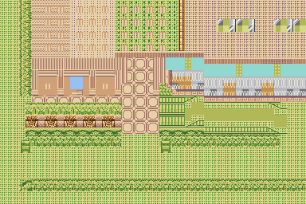

# Dernier / SteinsTree

A Game Boy Color game made in **GB Studio 4**, set in Manipal University
Jaipur. Three funny first-year days with five friends. A zombie outbreak that
takes them, one by one. Then a journey back through your whole life, and a
reunion at dawn that isn't real, and is enough. *Death is just the middle.*



## Play
- **Browser:** in this folder run `python3 -m http.server 8000`, then open
  http://localhost:8000. It's GB Studio 4's web player; browsers block it from
  `file://`. Controls: arrows or WASD, Z/J = A, X/K = B, Enter = Start,
  Shift = Select (change them in `gbstudio.json`).
- **Emulator:** drag `rom/game.gb` into BGB (`rom/bgb.exe`), SameBoy, mGBA or
  any GBC emulator. It is a Game Boy *Color* game.
- **GB Studio:** open `Dernier.json` and press Play.
- In game, **Start** opens the pause menu: current objective, bonds, save, and
  **Chapters**, a dev chapter select that can jump anywhere.

## What's in draft 1
| Part | Content |
|---|---|
| Prologue | 2009 bedroom, and a pocket-monster battle homage (original critters SPARKLET and GNAWBIT) |
| Act 1 | Three Persona-style days: Physics in AB1, Maths in AB2, Chemistry in AB3, the Workshop saw practical, the Quess Mess dinner, a cricket match, free-evening hangouts (bonds), a night walk behind B7 |
| Act 2 | The outbreak, starting from the original B7 scenes. Then Kanishk's turn-based siege, Parag's lane defence, Anshuman's stealth, Divyansh's speech battle and chase, Kanishk's last stand, Garvita's rooftop platformer, and Mayank under the Dome |
| Act 3 | "The Middle": a breathing starfield hub and seven life-story memories, each a different kind of play (exploration, shoot-'em-up, persistence, follow-the-figure, a slowed walk, palette-cycling stress, a low-ceiling platformer), then the Hall of Doors |
| Finale | Reunion at dawn on the cricket ground; lines change with bonds |

**The map:**
- A Chrono Trigger-style world map of the real MUJ campus, built from
  OpenStreetMap and satellite land cover.
- 16 local exteriors (every hostel block, AB1/2/3, the Dome, the pool, the
  underpass, the cricket ground, NBC, the workshop, the scrub forest behind B7)
  and 12 interiors.
- Emerald-style art in GBC colour: top-left light, cast shadows, and day,
  night, dusk, dream and memory palette banks. Your original B7 backgrounds
  are enriched into GBC copies; the originals are untouched.

## Edit it (no AI needed)
- **[docs/EDITING_GUIDE.md](docs/EDITING_GUIDE.md):** the easy guide.
- **Studio:** `python3 tools/studio/studio.py serve` opens a local web app with
  a story flow graph, scene viewer, dialogue editor, map, sprites and
  palettes.
- **Story bible:** [docs/STORY.md](docs/STORY.md).
- **Life-story levels:** [docs/LIFE.md](docs/LIFE.md).
- **Map notes:** [docs/MAP.md](docs/MAP.md).
- **Plan and refined brief:** [docs/PLAN.md](docs/PLAN.md).

## Rebuild from source (optional)
```
python3 tools/sprites/cast_build.py   # cast sprites
python3 tools/map/build_maps.py       # all maps
python3 tools/map/enrich.py           # GBC copies of the original backgrounds
python3 tools/game/build_game.py      # all scenes (hand-edited files are left alone)
python3 tools/game/check_maps.py      # layout audit
```
Then build in GB Studio (*Export ROM*), or headless with GB Studio's CLI
(see `tools/playtest/README.md`).

## Repository layout
| Path | What |
|---|---|
| `Dernier.json`, `project/` | The GB Studio project |
| `assets/` | Runtime art, music and fonts (GB Studio imports these) |
| `art/` | Editable sources, previews, OSM data, manifests |
| `tools/map/` | OSM campus pipeline, tile painter, maps, legacy enrichment |
| `tools/sprites/` | Cast sprite pixel data and builder |
| `tools/game/` | Story generator (`story/*.py`), validator, layout audit |
| `tools/studio/` | The studio (web + CLI) |
| `tools/playtest/` | Headless PyBoy playtest harness |
| `docs/` | Guide, story bible, life levels, map notes, plan |

## Credits
- Story, art direction and life: KC. Friends: Mayank, Divyansh, Kanishk,
  Parag, Anshuman, Garvita.
- Map data © OpenStreetMap contributors (ODbL). Land cover derived from Esri
  World Imagery samples (imagery not included).
- Music: GB Studio sample songs by Rulz (placeholders; replace before any
  release).
- Engine and editor: GB Studio by Chris Maltby and contributors.
- The pocket-monster battle is an homage with original art. No Nintendo
  assets are used in new content. The original B7 backgrounds are the owner's
  earlier study art; see `art/manifest.json`.

## Earlier version
The original B7 scenes from the first prototype are still in the game. They
are the B7 interiors and front, now with enriched GBC art, and the originals
are in `assets/backgrounds/`.
Sample gameplay video of that prototype:
[](https://youtu.be/ao587hBJDpk)

## Status
See "Draft 1 status" in [docs/PLAN.md](docs/PLAN.md).
